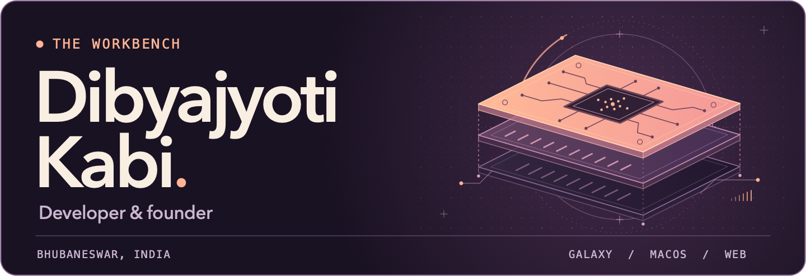

<!-- Profile README for github.com/Dibyajyotikabi. -->

I build tools for Galaxy users and developers. I founded [SamUpdater](https://samupdater.com/) and co-founded [Hatchnix](https://hatchnix.com/).

[Website](https://dibyajyotikabi.com/) &nbsp;·&nbsp; [Writing](https://blogs.dibyajyotikabi.com/)

## Selected work

### 01 / [SamUpdater](https://samupdater.com/)

See which firmware, One UI releases, betas, and test builds are available for your Galaxy model and region.

[Android app](https://github.com/Dibyajyotikabi/samupdater-app) &nbsp;·&nbsp; [Chrome extension](https://github.com/Dibyajyotikabi/samupdater-chrome-extension)

### 02 / [Model Hub](https://github.com/Dibyajyotikabi/model-hub)

Run local and hosted models from Codex with a macOS menu bar app and a local gateway.

### Also on the workbench

- [Billdot](https://github.com/Dibyajyotikabi/billdot): Invoices, quotes, and receipts for small agencies, with UPI payment support.
- [Lumen](https://github.com/Dibyajyotikabi/lumen-poster-generator): A browser studio for making posters and thumbnails. [Try it](https://lumen-poster-generator.vercel.app/).
